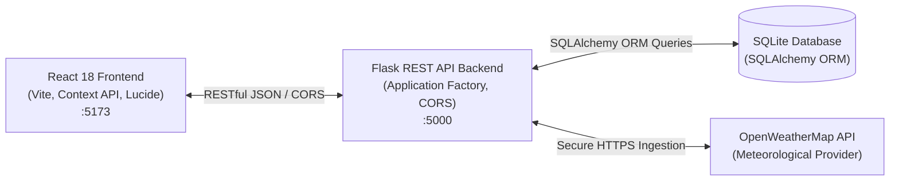

# WeatherPulse &mdash; Weather Forecast & Monitoring System
### Six-Week Internship Project | Python Development & Full Stack Web Development

[](https://www.python.org/)
[](https://flask.palletsprojects.com/)
[](https://react.dev/)
[](https://vitejs.dev/)
[](https://www.sqlite.org/)
[](https://www.sqlalchemy.org/)

---

## 1. Project Overview

**WeatherPulse** is an industry-grade, full-stack weather monitoring and forecasting platform developed as part of a structured **Six-Week Internship in Python Development and Full Stack Web Development**. 

The application enables users to search for cities globally, view real-time atmospheric metrics, explore five-day predictive forecasts, manage saved favorite locations, and inspect historical search audit trails. Designed with high architectural rigor, the platform decouples the React presentation layer from the Python Flask backend, guaranteeing zero client-side credential exposure, robust error resilience, and persistent SQLite storage through SQLAlchemy ORM.

---

## 2. System Architecture



---

## 3. Technology Stack

| Layer | Technologies |
|---|---|
| **Frontend** | React.js 18, Vite, JavaScript ES6+, HTML5, CSS3 Custom Properties, React Router DOM, React Context API, Axios, Lucide React Icons |
| **Backend** | Python 3.13, Flask 3.0, Flask-CORS, Flask-SQLAlchemy, Python Requests, Python Dotenv |
| **Database** | SQLite 3 with SQLAlchemy 2.0+ ORM |
| **External API** | OpenWeatherMap RESTful API (Current Weather & 5-Day Forecast Data) |
| **Testing** | Pytest, Flask Test Client |
| **Dev Tools** | Git, GitHub, VS Code, Browser DevTools |

---

## 4. Project Directory Structure

```text
Weather Forecast/
|-- backend/
|   |-- database/
|   |   |-- __init__.py           # Database init & auto-table generation
|   |   `-- weather.db            # SQLite database file
|   |-- models/
|   |   `-- __init__.py           # FavoriteCity & SearchHistory SQLAlchemy models
|   |-- routes/
|   |   `-- __init__.py           # Flask blueprints for weather, favorites & history
|   |-- services/
|   |   `-- __init__.py           # OpenWeatherMap consumption & caching services
|   |-- tests/                    # Pytest test suite
|   |-- app.py                    # Flask application factory & health check
|   |-- config.py                 # Multi-environment configuration loader
|   |-- requirements.txt          # Python dependencies
|   `-- .env.example              # Backend environment template
|
|-- frontend/
|   |-- public/                   # Static assets
|   |-- src/
|   |   |-- assets/               # Visual media and weather SVG assets
|   |   |-- components/           # Reusable UI components
|   |   |-- context/              # React Context API global state
|   |   |-- hooks/                # Custom React hooks
|   |   |-- pages/                # Application views (Dashboard, Details, Favorites, History, Settings)
|   |   |-- services/             # Axios API service clients
|   |   |-- App.jsx               # Root application component
|   |   |-- index.css             # Glassmorphism dark design system
|   |   `-- main.jsx              # React DOM entry point
|   |-- index.html                # HTML5 template
|   |-- package.json              # Frontend dependencies and npm scripts
|   |-- vite.config.js            # Vite configuration with proxy
|   `-- .env.example              # Frontend environment template
|
|-- docs/
|   |-- requirement_analysis.md   # Software Requirements Specification (SRS)
|   |-- architecture_design.md    # Multi-tier system architecture
|   |-- database_design.md        # Relational schema & data dictionary
|   |-- api_specification.md      # REST API contracts & JSON envelopes
|   `-- weekly_logs/
|       `-- week1_log.md          # Week 1 internship progress log
|
|-- screenshots/                  # Documentation & UI captures
|-- .gitignore                    # Version control ignore definitions
`-- README.md                     # Comprehensive project documentation
```

---

## 5. Localhost Setup & Installation Guide

### Prerequisites
- **Python 3.10+** (Python 3.13 verified)
- **Node.js v18+** (Node.js v24.14 verified)
- **npm** or **pnpm**
- **Git**

---

### Step 1: Clone & Navigate to Repository
```bash
git clone <repository-url>
cd "Weather Forecast"
```

---

### Step 2: Backend Setup (Flask & SQLite)

1. Navigate to the backend directory:
   ```bash
   cd backend
   ```

2. Create and activate a Python virtual environment:
   - **Windows:**
     ```powershell
     python -m venv venv
     .\venv\Scripts\activate
     ```
   - **macOS / Linux:**
     ```bash
     python3 -m venv venv
     source venv/bin/activate
     ```

3. Install required Python packages:
   ```bash
   pip install -r requirements.txt
   ```

4. Configure environment variables:
   ```bash
   cp .env.example .env
   ```
   *Edit `.env` and supply your OpenWeatherMap API key (`OPENWEATHER_API_KEY`).*

5. Run the Flask backend server:
   ```bash
   python app.py
   ```
   *The backend will boot on [http://localhost:5000](http://localhost:5000) and automatically initialize the SQLite database (`backend/database/weather.db`).*

---

### Step 3: Frontend Setup (React & Vite)

1. Open a new terminal and navigate to the frontend directory:
   ```bash
   cd frontend
   ```

2. Install npm dependencies:
   ```bash
   npm install
   ```

3. Launch the Vite development server:
   ```bash
   npm run dev
   ```
   *The frontend dashboard will be available at [http://localhost:5173](http://localhost:5173).*

---

## 6. Six-Week Development Schedule & Status

| Week | Focus Area | Status | Deliverables |
|---|---|:---:|---|
| **Week 1** | Requirement Analysis, Architecture & Environment Setup | **COMPLETED** | SRS, System Architecture, Database Schemas, API Contracts, Scaffolding, Health Check |
| **Week 2** | Python Flask Backend & OpenWeatherMap Integration | *Pending Approval* | RESTful endpoints (`/weather`, `/forecast`), timeout handling, service layers, Pytest suite |
| **Week 3** | React UI, Dashboard & Frontend Integration | Planned | Dashboard layout, SearchBar, CurrentWeather, Forecast cards, Axios client integration |
| **Week 4** | SQLite Integration, Favorites & History Modules | Planned | Database CRUD routes, React Context API state management, recent search logging |
| **Week 5** | Testing, Debugging, Temperature Conversion & Polish | Planned | Temperature toggle (°C/°F), theme switching, responsive design, integration tests |
| **Week 6** | Final Documentation, GitHub Completion & Demonstration | Planned | Final project report, screenshots, user manual, final presentation demo |

---

## 7. Internship Evaluation Criteria Compliance

- **Decoupled Architecture:** Strict separation between presentation and business logic.
- **Security Best Practices:** API credentials isolated server-side in `.env`.
- **Database Persistence:** Real SQLite database using SQLAlchemy ORM (no hardcoded/mock arrays).
- **Automated Testing:** Dedicated testing suite with Pytest.
- **Git Hygiene:** Clean, atomic commit history.
- **Comprehensive Documentation:** Full SRS, architecture, database schemas, and weekly progress logs.

