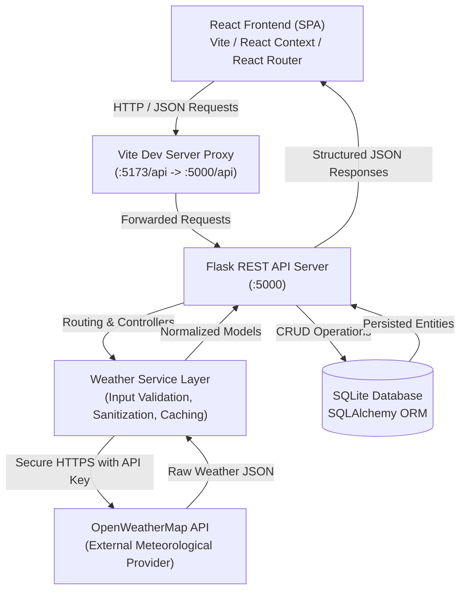
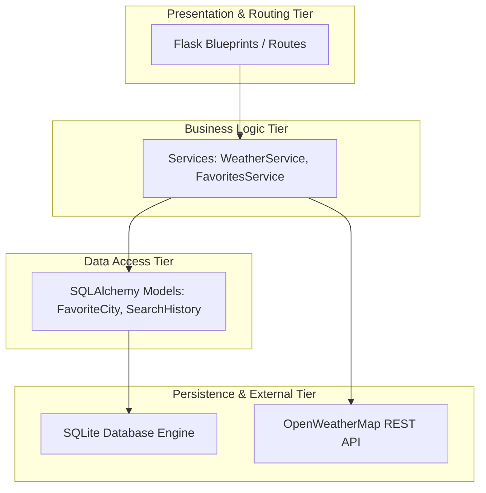
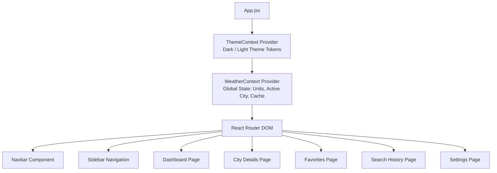

# System Architecture Design Document
## Project: Weather Forecast & Monitoring System
**Document Version:** 1.0.0  
**Phase:** Week 1 — Architecture Design  

---

### 1. High-Level System Architecture

The application adopts a **decoupled Client-Server Architecture** adhering to RESTful API conventions and strict separation of concerns. The frontend React Single-Page Application (SPA) acts as the presentation layer, while the Python Flask application serves as the API gateway, business logic orchestrator, and data access layer.

---

### 2. Layered Backend Architecture

The backend follows an industry-standard 4-tier modular pattern:

1. **Routing Tier (`backend/routes/`):**
   - Parses HTTP requests, URL parameters, query strings, and JSON request bodies.
   - Enforces preliminary validation and invokes corresponding services.
   - Serializes responses into standard JSON envelopes with explicit HTTP status codes (200, 201, 400, 404, 500).

2. **Service Tier (`backend/services/`):**
   - Implements business logic and data aggregation.
   - Interfaces with the external OpenWeatherMap endpoints using Python `requests` with configured request timeouts.
   - Transforms raw external API payloads into sanitized, normalized dictionaries tailored for the frontend.

3. **Data Access / ORM Tier (`backend/models/` & `backend/database/`):**
   - Defines declarative SQLAlchemy models (`FavoriteCity`, `SearchHistory`).
   - Encapsulates database transactions, preventing raw SQL injection vulnerabilities.
   - Provides serialization methods (`to_dict()`) for clean decoupling from the presentation layer.

4. **Configuration Tier (`backend/config.py`):**
   - Centralizes environment variable extraction (`python-dotenv`).
   - Segregates settings into `DevelopmentConfig`, `TestingConfig`, and `ProductionConfig`.

---

### 3. Frontend Architecture

The frontend is constructed using a modern React component-tree hierarchy:

---

### 4. Security & Credential Protection Model

1. **Zero Secret Leakage:** The OpenWeatherMap API key is stored exclusively in `backend/.env`. It is loaded server-side into Python memory and injected into upstream outbound HTTPS requests. It is never transmitted across the browser boundary or bundled into JavaScript client code.
2. **CORS Governance:** `flask-cors` is configured to only whitelist trusted frontend origins (`http://localhost:5173` and `http://127.0.0.1:5173`), preventing unauthorized cross-origin abuse.
3. **Parameterized SQL Queries:** SQLAlchemy ORM compiles queries using parameterized statements, neutralizing SQL injection vectors.
4. **Input Sanitization:** User-supplied city queries are stripped of control characters, leading/trailing whitespaces, and validated against character-length limits prior to upstream dispatch.

