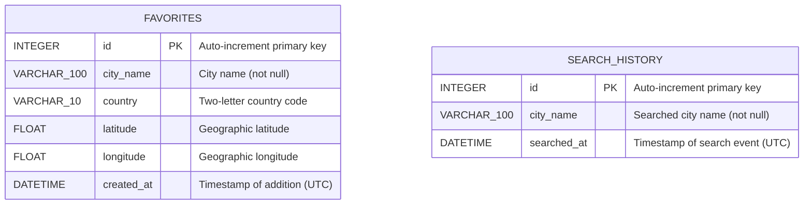

# Database Design & Schema Specification
## Project: Weather Forecast & Monitoring System
**Document Version:** 1.0.0  
**Phase:** Week 1 — Database Planning & Schema Design  

---

### 1. Database Overview

The persistence layer utilizes **SQLite 3** managed through the **SQLAlchemy 2.0+ ORM**. SQLite provides an ACID-compliant, zero-configuration relational database engine embedded directly within the application execution context. Tables are automatically inspected and generated on application bootstrap via `init_db(app)` in `backend/database/__init__.py`.

---

### 2. Entity-Relationship Diagram (ERD)

---

### 3. Data Dictionary

#### 3.1 `favorites` Table
Stores user-bookmarked cities for persistent access across application sessions.

| Column Name | Data Type | Constraints | Default | Description |
|---|---|---|---|---|
| `id` | `INTEGER` | Primary Key, Autoincrement | Auto | Unique identifier for each favorited city record |
| `city_name` | `VARCHAR(100)` | NOT NULL | - | Name of the bookmarked city (e.g., "London", "Tokyo") |
| `country` | `VARCHAR(10)` | NULLABLE | NULL | ISO 3166-1 alpha-2 country code (e.g., "GB", "JP") |
| `latitude` | `FLOAT` | NULLABLE | NULL | Decimal degrees latitude coordinate |
| `longitude` | `FLOAT` | NULLABLE | NULL | Decimal degrees longitude coordinate |
| `created_at` | `DATETIME` | NOT NULL | `UTC NOW` | Timestamp representing when the favorite was created |

#### 3.2 `search_history` Table
Maintains an audit trail of searched cities for rapid re-querying and recent search suggestions.

| Column Name | Data Type | Constraints | Default | Description |
|---|---|---|---|---|
| `id` | `INTEGER` | Primary Key, Autoincrement | Auto | Unique identifier for each historical search record |
| `city_name` | `VARCHAR(100)` | NOT NULL | - | City name queried by the client |
| `searched_at` | `DATETIME` | NOT NULL | `UTC NOW` | Timestamp representing when the search occurred |

---

### 4. Normalization & Integrity Rationale

1. **Third Normal Form (3NF):** Both tables are structured in 3NF; all attributes functionally depend directly on their respective primary keys (`id`) without transitive dependencies.
2. **Timezone Uniformity:** All datetime fields store epoch timestamps in **Coordinated Universal Time (UTC)** using Python's `datetime.now(timezone.utc)` to avoid daylight saving and local machine timezone discrepancies.
3. **Data Types & Portability:** Data types are selected to ensure seamless portability across SQLite, PostgreSQL, and MySQL if migrated in future iterations.

---

### 5. Indexing & Query Optimization

- **Primary Key Indexes:** SQLite automatically constructs unique B-Tree indexes on `favorites.id` and `search_history.id`.
- **Query Sorting:** Recent searches are queried via `ORDER BY searched_at DESC LIMIT 10`, benefiting from index-assisted lookups.
- **De-duplication Logic:** Before inserting a new favorite, the application checks `SELECT id FROM favorites WHERE LOWER(city_name) = LOWER(:city)` to prevent duplicate records.

